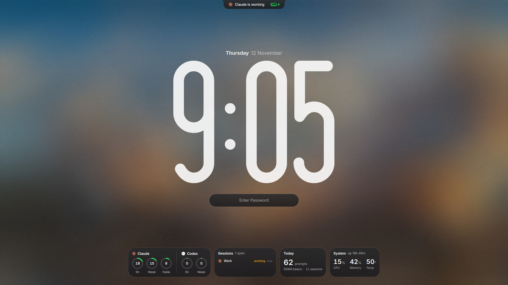

# Lock screen

Omarchy's lock screen, restyled to match the notch
([omarchy-notch](https://github.com/mikaelendale/omarchy-notch)). It's a clone
of `omarchy.lock`: the unlocking itself (`Service.qml`, password and
fingerprint) is Omarchy's code.



## Install

```bash
omarchy plugin add https://github.com/mikaelendale/omarchy-lock-screen.git --enable
omarchy restart shell
```

Enabling it switches Omarchy's own lock screen off. The shell only picks up a
lock screen when it starts, hence the restart. Then try it without locking:
`omarchy-shell lock preview` (click to close).

Update with `omarchy plugin update mike.lock` and `omarchy restart shell`.

The sessions widget and the agent status in the notch read your sessions with
the notch's collector, so they need
[omarchy-notch](https://github.com/mikaelendale/omarchy-notch) installed.
Without it, those just show no sessions. Plan limits come from Omarchy's own
agents panel, so sign in to your agents there (`omarchy agent`).

What it shows:

- **The wallpaper, blurred**, with a wash in the theme's background colour and a
  soft grain so the blur doesn't band.
- **A notch at the top**: what your agents are doing ("Claude needs you",
  "Claude is working", or "Locked"), with the battery.
- **The date and the time.** The digits are tall and rounded, drawn from the
  plugin's own shapes (`decor/Glyphs.js`), in plain white, a little
  see-through (the theme's text colour on light themes). Each digit rolls
  over when the minute changes.
- **The password field**: a pill of the notch's frosted glass. An arrow button
  appears once you type, and a wrong password shakes the field.
- **A row of small glass widgets** floating above the bottom edge:
  - Claude's and Codex's plan limits as rings. Hover to see when each resets.
  - Open sessions. Only the project folder is shown, never the conversation's
    title.
  - Today's prompts, tokens and sessions.
  - CPU, memory, temperature and uptime.
  - What's playing, with back, play/pause and skip (only while something
    plays).

Colours follow the current Omarchy theme, light or dark, as the notch does.

## Files

| File | What it does |
| --- | --- |
| `LockView.qml` | The wallpaper, blur and password field. Only what unlocking needs. |
| `decor/LockDecor.qml` | The notch, time, cards and intro. Pure visuals. |
| `decor/LockData.qml` | Feeds LockDecor while the lock shows: sessions from the notch's `agents.py`, limits from `usage.py`, and battery. |
| `decor/usage.py` | Reads `~/.local/state/omarchy/agents/usage/*.json`, which Omarchy's agents panel keeps current: limits and today's totals. |
| `decor/system.py` | CPU, memory, temperature and uptime. |
| `decor/TallClock.qml`, `ClockGlyph.qml`, `Glyphs.js` | The clock and its digit shapes. |
| `decor/*` | The notch's Theme, marks and battery (copies), the widgets, and the notch shape. |
| `Service.qml` | Omarchy's, plus `quietPreview`: a preview that doesn't take the keyboard. The unlocking itself is unchanged. |
| `FingerprintModel.js`, `poster.sh` | Omarchy's, unchanged. |

`LockView.qml` loads everything in `decor/` through Loaders. If anything there
ever fails to load, the password field still works and the screen still
unlocks; it just looks plain.

## Changing it

- The shell doesn't hot-reload the lock (it's an authentication service), so
  run `omarchy restart shell` after editing.
- `omarchy-shell lock preview` shows it without locking; click to close it. It
  takes the keyboard while it's up. `omarchy-shell lock quietPreview` doesn't
  (close it with `omarchy-shell lock hidePreview`).
- `tests/run.sh [outdir]` draws every case off screen: dark, light, typing,
  wrong password, many sessions, none, the intro and the minute roll frame by
  frame, and the shake. `tests/ClockHarness.qml` draws the digits alone.
  Off screen, shapes that cross themselves don't show the double-drawn
  overlap the GPU gives see-through strokes, so check the clock live too.
  `tests/mock` stands in for Omarchy's `qs.Commons` and `qs.Ui`.

## Going back to Omarchy's lock screen

```bash
omarchy plugin disable mike.lock && omarchy plugin enable omarchy.lock && omarchy restart shell
```

If a lock screen ever gets stuck, press Ctrl+Alt+F2, log in, and run the same
command.
